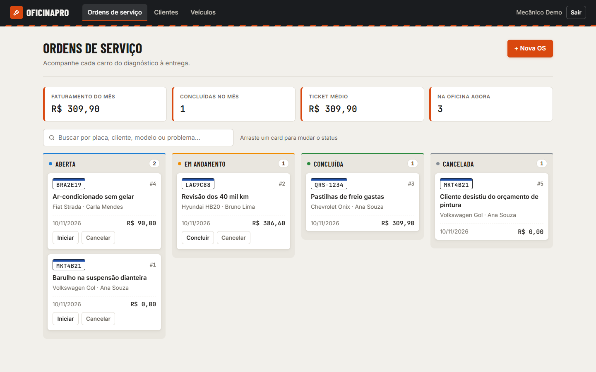

# OficinaPro

[](https://github.com/Batalha-Dev/oficinapro/actions/workflows/ci.yml)

Sistema web para uma pequena oficina mecânica controlar **clientes**, **veículos** e **ordens de serviço (OS)**. Cada OS percorre um quadro kanban (Aberta → Em andamento → Concluída/Cancelada), com peças e serviços lançados e o valor total calculado automaticamente.

**Funcionalidades:** login do mecânico · kanban com busca e arrastar cards · números do mês (faturamento, ticket médio) · cadastro de clientes e veículos · histórico de cada veículo · peças e serviços por OS.

Trabalho da disciplina **Laboratório de Programação** (Ciência da Computação, UNIFACVEST). Professor: Willen Leolatto Carneiro. O projeto foi desenvolvido com auxílio de IA, e o processo está documentado em [`DOCUMENTACAO_IA.md`](DOCUMENTACAO_IA.md).



## Stack

| Camada | Tecnologia |
|---|---|
| Backend | Node.js 22–24, Express 5, nodemon |
| Banco | PostgreSQL 16 (Docker Compose) |
| ORM | Prisma 6 (schema + migrações) |
| Validação | zod |
| Autenticação | JWT (jsonwebtoken) + senhas com bcrypt |
| Frontend | React 18 + Vite 5 + React Router |
| Testes | Jest + supertest (55, backend) · Vitest + Testing Library (18, frontend) |
| Qualidade | ESLint 9, Prettier, GitHub Actions (Node 22 e 24) |

## Pré-requisitos

- **Node.js 22.x a 24.x** (`node -v`). O arquivo `.nvmrc` indica a versão 22.
- **Docker Desktop** em execução (`docker info` precisa responder).
- Git.

## Como rodar (primeira vez)

```bash
git clone https://github.com/Batalha-Dev/oficinapro.git
cd oficinapro
npm install                     # instala o concurrently da raiz
npm run db:up                   # sobe o PostgreSQL 16 no Docker
cp backend/.env.example backend/.env
npm run setup                   # instala dependências, aplica migrações e popula dados de exemplo
npm run dev                     # sobe API (3333) e frontend (5173) juntos
```

Depois abra **http://localhost:5173** e entre com o usuário de demonstração:

| E-mail | Senha |
|---|---|
| `mecanico@oficinapro.com` | `oficina123` |

> Usuário criado pelo seed só para o ambiente local. O `JWT_SECRET` do `.env` deve ser trocado em qualquer outro ambiente.

> No Windows (PowerShell), use `copy backend\.env.example backend\.env` no lugar do `cp`.

## Scripts úteis

| Comando (na raiz) | O que faz |
|---|---|
| `npm run dev` | API com nodemon + frontend Vite |
| `npm test` | testes do backend (banco `oficina_test`) e do frontend |
| `npm run lint` / `npm run format` | ESLint / Prettier |
| `npm run demo:reset` | **plano B**: apaga o banco e recria tudo com os dados de demonstração (no PowerShell: `powershell -File scripts
eset-demo.ps1`) |
| `npm run db:up` / `db:down` | liga/desliga o container do banco |
| `npm run seed --prefix backend` | recria os dados de demonstração |

## Estrutura

```
backend/
  prisma/            schema.prisma, migrações e seed
  src/
    routes/          só mapeiam URL → controller
    controllers/     camada HTTP (lê req, valida, responde)
    services/        regras de negócio + Prisma
    validators/      schemas zod
    middlewares/     errorHandler central e autenticar (JWT)
  tests/             Jest + supertest
frontend/src/
  api/               cliente fetch + hook useRecurso
  components/        Layout, Modal, Crud genérico, estados
  lib/               regras puras do kanban (busca, arrastar)
  pages/             Login, Painel, Clientes, Veículos, Histórico, OrdemDetalhe
docs/                arquitetura, roteiro da apresentação, spec, plano e prints
.github/workflows/   CI
docker-compose.yml   PostgreSQL 16 + banco de teste
DOCUMENTACAO_IA.md   registro do uso de IA (obrigatório)
```

## API

Prefixo `/api`. Todas as rotas, exceto `/auth/login` e `/health`, exigem `Authorization: Bearer <token>`. Erros sempre no formato `{ "erro": "...", "detalhes"?: [...] }`.

| Método | Rota | Descrição |
|---|---|---|
| POST | `/auth/login` | `{ email, senha }` → `{ token, usuario }` (401 se incorreto) |
| GET | `/auth/eu` | usuário do token |
| GET | `/resumo` | OS por status, faturamento e ticket médio do mês |
| GET/POST | `/clientes` | lista (`?busca=`) / cria |
| GET/PUT/DELETE | `/clientes/:id` | detalhe / edita / exclui (409 se tiver veículos) |
| GET/POST | `/veiculos` | lista (`?clienteId=`) / cria |
| GET/PUT/DELETE | `/veiculos/:id` | detalhe / edita / exclui (409 se tiver OS) |
| GET/POST | `/ordens` | lista (`?status=`, `?veiculoId=`) / abre OS |
| GET/PUT/DELETE | `/ordens/:id` | detalhe com total / edita descrição / exclui |
| PATCH | `/ordens/:id/status` | muda status (422 se a transição for inválida) |
| POST | `/ordens/:id/itens` | adiciona peça/serviço |
| DELETE | `/ordens/:id/itens/:itemId` | remove item |
| GET | `/health` | verificação de saúde |

## Regras de negócio

1. Placa no formato antigo (`ABC1234`) ou Mercosul (`ABC1D23`), normalizada para maiúsculas e sem hífen. Placa é única.
2. Cliente com veículos não pode ser excluído.
3. Veículo com ordens de serviço não pode ser excluído (preserva o histórico).
4. O valor total da OS é calculado no servidor (soma de quantidade × valor unitário).
5. Transições permitidas: Aberta → Em andamento ou Cancelada; Em andamento → Concluída ou Cancelada.
6. OS concluída ou cancelada não aceita alterações.
7. Ao concluir, a data de conclusão é registrada.

## Gestão do projeto

- Kanban: [GitHub Projects — OficinaPro](https://github.com/users/Batalha-Dev/projects/2/views/2). Os prints da evolução estão em [`docs/kanban-prints/`](docs/kanban-prints).
- Issues fechadas automaticamente pelos commits (`Closes #n`), seguindo Semantic Commits.
- Roteiro da apresentação: [`docs/roteiro-apresentacao.md`](docs/roteiro-apresentacao.md).
- Especificação: [`docs/superpowers/specs/`](docs/superpowers/specs). Plano: [`docs/superpowers/plans/`](docs/superpowers/plans). Arquitetura: [`docs/arquitetura.md`](docs/arquitetura.md).

## Problemas comuns

| Sintoma | Solução |
|---|---|
| `Can't reach database server` | O Docker não está rodando. Abra o Docker Desktop e rode `npm run db:up`. |
| Porta 5432 ocupada | Há um PostgreSQL local instalado. Pare o serviço dele ou mude a porta no `docker-compose.yml` e no `.env`. |
| Volta para a tela de login sozinho | A sessão (8 h) expirou ou o `JWT_SECRET` mudou. Entre de novo. |
| Frontend mostra "Não foi possível conectar à API" | O backend não subiu. Veja o terminal do `npm run dev`. |
